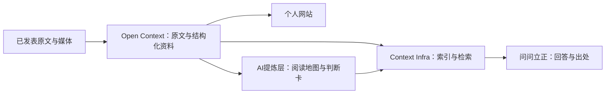

# 资料与调用架构

事实依据主要来自已经发表的原文和媒体。Open Context保存这些来源的可追溯文本版本，以及有来源支持的人物、节目等结构化记录，是各产品统一维护资料的地方。Context Infra负责使用资料；个人网站展示人物和节目，问问立正检索原文、组织证据和生成回答。

| 部分 | 保存什么 | 负责什么 |
|---|---|---|
| Open Context · `corpus/` | 原稿、精校文本、时间码、发言者、来源版本和质量 | 可核对、可引用的原始资料 |
| Open Context · `catalog/` | 人物、姓名与别名、节目、参与关系、伴读链接 | 各产品共享的结构化事实 |
| Open Context · `context/` | 有来源的阅读地图、摘要和判断卡 | 单独维护的AI提炼层，帮助阅读和组织材料 |
| Context Infra · 问问立正 | 解析、切块、索引、召回、证据组装、回答协议 | 更有效地调用资料 |
| 个人网站 | 页面、导航、展示与静态输出 | 按同一目录展示嘉宾和节目 |

## 发表来源与统一记录

文章原文、视频音画和节目中的介绍提供原始依据。采集保存来源地址、发表时间、采集时间及对应版本；精校文字回到实际发表的原文或媒体核对。人物身份和节目关系也从这些来源建立。网站上的旧介绍可以提供线索，事实更新以对应的发表依据和时间为准。

Open Context是共享资料的唯一维护入口。它保存的文字和结构化记录可以持续校准；原始出处提供事实依据，仓库版本提供可重现的引用。作者表达了一个观点，与这个观点已经被证实，是两种不同的陈述。AI提炼回指其使用的原文。

## 稳定身份，可更新事实

人物ID标识同一个实体，姓名、别名和介绍可持续校准。节目由来源ID标识，人物与节目的参与关系单独存储。`catalog/guests.json`维护这三类记录；`catalog/guest-articles.json`维护伴读文章及其来源关系。网页地址解析到稳定人物ID。

文本版本记录来源、质量和修改依据。字幕单元保留实际措辞、对应时间码及发言者；精校更新文字的可靠性。录制版本、发表版本和文本版本各自有身份，引用定位到实际文本对应的媒体。

身份关联以节目中的介绍、作者元数据和明确来源链接为依据。姓名是检索入口；同名记录保留各自身份，别名可指向多个人物。多人组合使用组合实体并写明成员，成员有自己的人物页时互相关联，个人参与关系单独记录。维护工具和AI承担内容验证：核对原始证据、检查全库关联、验证实际检索与回答，并保存来源版本和回执。更新资料完成这些验证后发布。

原始资料与AI提炼分层。提炼回指原文，独立更新；新原稿可直接进入检索。参与关系用于按人找节目，具体发言归属由字幕单元记录。

问问立正的普通回答以立正的直接来源为依据：文章、单人主讲及对谈中可确认属于他的发言。对谈保持独立的节目索引，在找资料时按嘉宾或话题检索全文；按嘉宾搜索直接返回相关节目和原文片段，回答与网页分别展示主讲材料和对谈入口。检索先确定来源用途，再在该范围内排序。AI提炼辅助定位，并回到被选中的原文组织证据。

## 一份数据，多处使用

本地素材库采集媒体、转写、校对并保留过程证据。公开版本进入Open Context，通过`release-manifest.json`固定文件、数量、许可和hash。重复出现的事实只维护一处，其余副本（视频目录里的嘉宾名字、节目标题、对谈原稿位置，以及名字表）由发布脚本自动生成，见[来源模型](source-model.md#由脚本推出的字段)。

推送main后，问问立正和网站都会自动拉取新release：网站生成目录快照和版本记录，构建校验实际快照hash。Context Infra先验证完整候选语料与固定版本记录，再替换构建副本并生成索引。消费者各自通过Git提交和部署发布固定版本，最终验收核对两处实际使用的release。缓存、向量、排序和回答是消费者的产物，可按需重建。资料修改回到Open Context，检索策略和产品功能修改在消费者中进行。

## 稳定性来自数据与职责

稳定身份、独立的参与关系和单一事实维护入口，让姓名修改、资料补充及页面更新沿同一数据流传播。原文与提炼分层，检索先确定用途再排序，让各类材料从进入系统时就有明确角色。

采集和校准在资料更新时进行。在线检索使用已经生成的固定快照，原网页暂时不可用不会改变当前回答依据。新来源形成新的资料版本，消费者的副本、索引和页面由该版本重建。

数量和文件清单由数据生成，统一见[目录](../INDEX.md)与[release manifest](../release-manifest.json)。维护检查验证关系、来源与版本合同；实际问题用于评估解释和回答质量。正确性的基础是这些数据模型与使用规则，测试数量不能替代它们。

## 更新流程

1. 从已发表来源采集或校准原文与结构化事实，保存出处、日期、版本和使用许可。
2. 生成Open Context release，审阅准确变更。
3. 网站同步固定版本；问问立正更新语料并增量构建索引。
4. 部署后核验页面、来源链接、实际查询及`/api/meta`版本。

数据字段见[来源模型](source-model.md)，字幕格式见[对谈资料](dialogue-ingestion.md)，调用实现见[问问立正](https://github.com/sunyuzheng/ask-lizheng/blob/main/docs/CONTEXT_ARCHITECTURE.md)。
