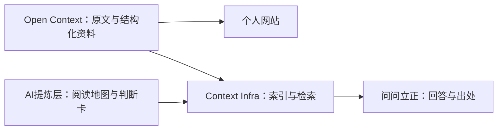

# 资料与调用架构

Open Context维护公开资料；Context Infra负责使用资料。个人网站展示人物和节目，问问立正通过Context Infra检索原文、组织证据和生成回答。

| 部分 | 保存什么 | 负责什么 |
|---|---|---|
| Open Context · `corpus/` | 原稿、精校文本、时间码、发言者、来源版本和质量 | 可核对、可引用的原始资料 |
| Open Context · `catalog/` | 人物、姓名与别名、节目、参与关系、伴读链接 | 各产品共享的结构化事实 |
| Open Context · `context/` | 有来源的阅读地图、摘要和判断卡 | 单独维护的AI提炼层，帮助阅读和组织材料 |
| Context Infra · 问问立正 | 解析、切块、索引、召回、证据组装、回答协议 | 更有效地调用资料 |
| 个人网站 | 页面、导航、展示与静态输出 | 按同一目录展示嘉宾和节目 |

## 稳定身份，可更新事实

人物ID标识同一个实体，姓名、别名和介绍可持续校准。节目由来源ID标识，人物与节目的参与关系单独存储。`catalog/guests.json`维护这三类记录；`catalog/guest-articles.json`维护伴读文章及其来源关系。网页地址解析到稳定人物ID。

文本版本记录来源、质量和修改依据。字幕单元保留实际措辞、对应时间码及发言者；精校更新文字的可靠性。录制版本、发表版本和文本版本各自有身份，引用定位到实际文本对应的媒体。

原始资料与AI提炼分层。提炼回指原文，独立更新；新原稿可直接进入检索。参与关系用于按人找节目，具体发言归属由字幕单元记录。

## 一份数据，多处使用

本地素材库采集媒体、转写、校对并保留过程证据。公开版本进入Open Context，通过`release-manifest.json`固定文件、数量、许可和hash。

网站从指定commit与manifest生成一份部署快照。Context Infra从同一release生成语料副本与索引。缓存、向量、排序和回答是消费者的产物，可按需重建。资料修改回到Open Context，检索策略和产品功能修改在消费者中进行。

## 更新流程

1. 更新原文或结构化事实，校验身份、引用、质量和许可。
2. 生成Open Context release，审阅准确变更。
3. 网站同步固定版本；问问立正更新语料并增量构建索引。
4. 部署后核验页面、来源链接、实际查询及`/api/meta`版本。

数据字段见[来源模型](source-model.md)，字幕格式见[对谈资料](dialogue-ingestion.md)，调用实现见[问问立正](https://github.com/sunyuzheng/ask-lizheng/blob/main/docs/CONTEXT_ARCHITECTURE.md)。
